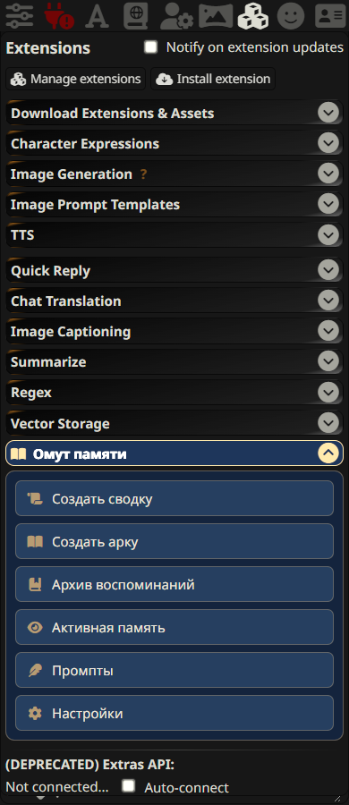
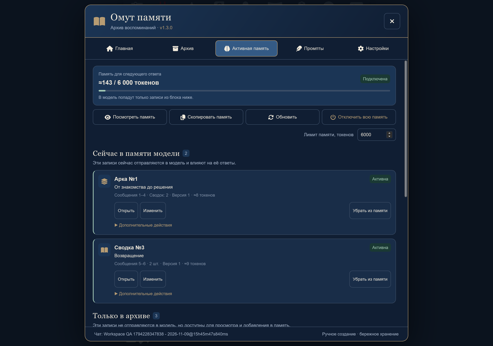
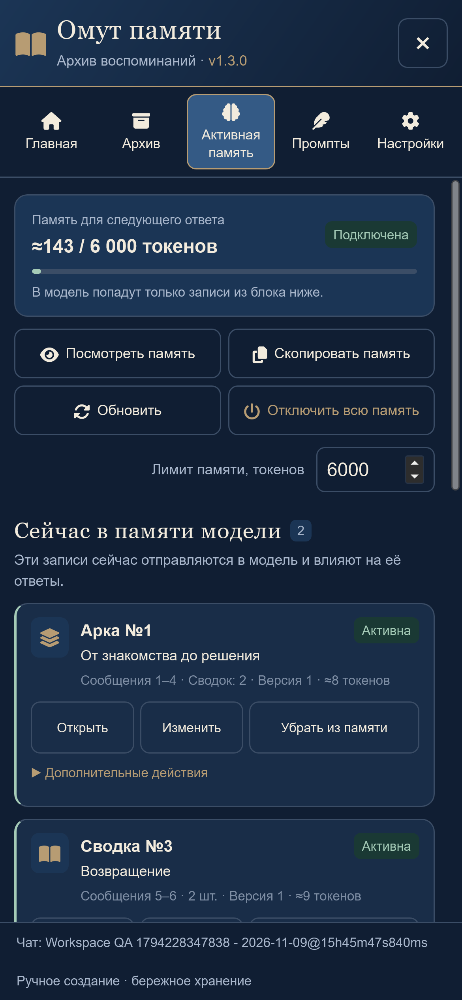

# Омут памяти · Pensieve

Ручной архив долгосрочной памяти для **SillyTavern 1.19.0 и новее**. Вы выбираете сообщения, проверяете сводку и сохраняете её. Подтверждённая память автоматически передаётся модели, а обработанные реплики при включённой настройке исключаются из контекста через штатный Hide. История остаётся в чате.

Расширение самостоятельно не создаёт сводки, не строит арки и не выбирает воспоминания. Оно универсально для любых персонажей, жанров и ролевых миров.

## Установка

1. Откройте **Расширения → Установить расширение / Install extension** в SillyTavern.
2. Вставьте адрес: **https://github.com/PavelSkellig/SillyTavern-Pensieve**.
3. Установите расширение и перезагрузите страницу.
4. В настройках расширений раскройте строку **«Омут памяти»** со стрелкой справа. Внутри доступны **«Создать сводку»**, **«Создать арку»**, **«Архив воспоминаний»**, **«Активная память»**, **«Промпты»** и **«Настройки»**. Второй вход доступен через меню расширений рядом с полем ввода.

Для обновления существующей установки нажмите **Обновить** у «Омута памяти» в списке управления расширениями и перезагрузите страницу. Версия **1.3.0** внедряет согласованный интерфейс с акцентом на фактическую память модели: статус, токены, быстрые действия и две отдельные группы записей. В заголовке должна появиться отметка **v1.3.0** — версия загруженного кода интерфейса. Генерация, промпты, хранение, Hide и сборка памяти остаются такими же, как в 1.2.1. Формат данных прежний, миграция и очистка не выполняются. Перед обновлением можно сохранить копию через **Настройки → Экспорт архива JSON**.

Требуется разрешённая установка сторонних UI-расширений. Отдельный серверный плагин, Lorebook, дополнительные ключи и внешняя база данных не нужны. Используется текущее подключение SillyTavern к модели. Сборка и установка npm-зависимостей для использования не требуются.

Поддерживается отдельная генерация через **Chat Completion** и стандартные **Text Completion** API SillyTavern: textgenerationwebui, Kobold, Horde, NovelAI. Полный интеграционный сценарий проверен на Chat Completion с OpenAI-совместимым тестовым ответом. Поведение каждого внешнего провайдера отдельно не проверялось.

## Первый запуск

1. Откройте сохранённый чат персонажа или группы.
2. Перейдите в **Промпты → Промпт сводки**, вставьте свои правила и нажмите **«Сохранить промпт»**.
3. Отдельно заполните **«Промпт арки»**. Оба редактора изначально пустые: расширение не навязывает структуру и стиль пересказа.
4. Для каждого промпта можно создавать и переименовывать пресеты, загружать текст из `.txt`/`.md`, экспортировать его и возвращаться к предыдущей сохранённой версии.

Промпты используются буквально, включая Markdown и текст вида `{{char}}`: расширение не подменяет их в запросе сводки/арки. Реальные даты отправки сообщений не добавляются к сюжетному тексту; даты, записанные внутри реплик, сохраняются.

## Создание сводки

1. Раскройте дополнительное меню нужного сообщения и нажмите **иконку закладки с плюсом** — начало сводки.
2. У последнего сообщения нажмите **иконку закладки с галочкой** — конец сводки. Обе границы входят в выборку. Подсказки и названия для экранного диктора сохранены; длинных подписей в меню нет.
3. Выбор границы оставляет уведомление и отметку в чате, **не открывая окно**. Откройте «Омут памяти → Создать сводку» вручную и проверьте начало, конец, число сообщений и короткие фрагменты. **«Показать подробнее»** раскрывает все выбранные сообщения целиком с отдельной прокруткой. Границы также можно ввести или изменить вручную. **В панели номера начинаются с 1**; внутренний номер SillyTavern может начинаться с 0.
4. Нажмите **«Создать сводку»**. Это отдельный запрос, который не добавляет видимую реплику и не продолжает сцену.
5. В предварительном просмотре отредактируйте название и полный текст, скопируйте или повторите генерацию.
6. Нажмите **«Сохранить»**. Расширение сохранит архив, прочитает его с сервера для проверки и только после этого исключит исходники, если соответствующая настройка включена.

До подтверждения исходные сообщения не исключаются. Отмена, пустой ответ, ошибка модели или неподтверждённая запись не позволяют начать исключение. Если вход превышает контекст модели с резервом для ответа, генерация останавливается с пояснением; текст не обрезается. Уменьшите диапазон либо увеличьте контекст в настройках подключения.

Для повторно выбранных источников показывается небольшая заметка **«Уже сохранено в сводке №…»**. Прежняя защита остаётся: требуется явное разрешение на отдельную версию или замену выбранной записи. Замена сохраняет ID и предыдущий текст; для неё требуется тот же состав источников. При изменении диапазона создайте отдельную версию.

Закрытие основного окна диапазон не сбрасывает. Для очистки есть **«Сбросить диапазон»**. Границы хранятся отдельно для каждого чата как временное состояние текущей вкладки браузера (`sessionStorage`), переживают перезагрузку страницы и не записываются в тексты реплик или архив воспоминаний. При удалении, изменении или неоднозначном совпадении источника соответствующая граница сбрасывается с пояснением; похожая реплика не подменяет удалённую. Если браузер запрещает это хранилище, выбор остаётся доступен до перезагрузки в памяти страницы.

## Сюжетные арки

1. Откройте **Архив → Сводки** и отметьте минимум две сводки.
2. После выбора появляется панель с полным списком. По умолчанию сводки расположены по исходным сообщениям. Кнопками **↑ / ↓** можно задать ручной порядок, а **«По исходным сообщениям»** — вернуть автоматический. Фильтр и поиск не снимают скрытые ими отметки. Если сводки уже входят в арки, появится предупреждение.
3. Нажмите **«Создать арку»**. Модель получит выбранные тексты **ровно в показанном порядке** и ваш промпт арки без дополнительных инструкций.
4. Проверьте, отредактируйте и сохраните результат.

Арка становится активной, выбранные сводки деактивируются и остаются в архиве. При ручной активации связанной сводки активная арка всё равно подавляет её отдельное внедрение. Две активные арки с пересекающимися источниками блокируют обычную генерацию с предложением отключить одну из них. При удалении арки можно вернуть её исходные сводки в активную память.

Изменение сводки, использованной в арке, помечает арку **«Требует проверки»**. Переписывание арки автоматически не запускается.

## Активная память

Первый вход через меню рядом с полем ввода открывает **«Активную память»**. Сверху видны фактически подготовленный объём, лимит и состояние подключения. Кнопки позволяют посмотреть точный текст, скопировать, обновить и глобально выключить память. В обычный запрос персонажа SillyTavern самостоятельно добавит последние доступные сообщения; расширение не дублирует их.

Список разделён на **«Сейчас в памяти модели»** и **«Только в архиве»** с пояснениями и счётчиками. Первая секция соответствует реально сформированной вставке для следующего запроса, вторая содержит все остальные записи. Карточки показывают иконку, номер, название, источники, версию, токены и чип статуса. Управление выполняется кнопками **«Добавить в память» / «Убрать из памяти»**. Пока сводку заменяет активная арка, отдельное добавление недоступно и подписано пояснением; сначала отключите арку. В архиве сохранены поиск по полному тексту, фильтр **Все / Активные / Неактивные** и выбор для арки.

Статусы в карточках:

- **Активна** — включена в текущий сформированный блок.
- **В архиве** — сохранена, но сейчас отдельно не внедряется.
- **Входит в арку №X** — представлена активной аркой и отдельно не добавляется.
- **Не помещается в лимит** — выбрана для памяти, но весь блок заблокирован из-за лимита памяти или контекста модели.
- **Требует проверки** — изменены источники или связанная сводка; доступно пояснение.
- **Выбрана для арки** — временная отметка выбора; она показывается отдельно от статуса памяти.

При общем отключении внедрения записи не помечаются как фактически активные. При превышении лимита существующий механизм блокирует **весь** блок, а не отбрасывает отдельные воспоминания: секция текущей памяти становится пустой, выбранные записи получают пояснение о блокировке. Можно посмотреть как фактический блок, так и отдельно подписанный предварительный текст выбранных записей. Изменение активности и лимита обновляет интерфейс без перезагрузки. Технические пояснения доступны в **«Дополнительных действиях»**, общее описание фильтра — в **«Об активности записей»**.

Настройки позволяют выбрать позицию и глубину внедрения, общий лимит памяти и включить/отключить редактируемую пометку о прошлых событиях. По умолчанию: память включена, предел 6000 токенов, системная вставка в историю на глубине 4, исключение после сохранения включено, визуальное сворачивание выключено.

Арки и самостоятельные сводки чередуются в блоке по текущему расположению исходных сообщений. Диапазон арки определяется через её сводки. Даты в тексте, дата создания и номер записи не влияют на сортировку; названия и тексты не переписываются. Если источники потеряны, неоднозначны или диапазоны пересекаются, сохраняется показанный/ранее действовавший порядок с предупреждением. Для арки можно подтвердить свою последовательность стрелками. Удалённые источники не подменяются сохранёнными номерами сообщений.

**Если память превышает установленный предел, обычная генерация останавливается.** Расширение не сокращает воспоминания и не выбирает их за вас. Отключите отдельные записи, создайте арку или увеличьте допустимый лимит. Количество токенов приблизительное; точный расчёт зависит от модели и токенизатора.

**«Отключить всю память»** выключает общее внедрение, сохраняя выбранные записи и архив. **«Включить память»** возвращает прежнюю подборку; кнопка также включает расширение, если оно было отключено целиком. При выключении в статусе показаны нулевой фактический объём и пустая секция текущей памяти, отдельно подписан объём выбранных записей. Состояние сохраняется после перезагрузки. Ранее исключённые сообщения остаются в своём состоянии: для возвращения используйте восстановление.

Общие **«Промпты»** и **«Настройки»** доступны без открытого чата, включая пресеты и резервную копию промптов. Для операций с архивом и восстановления нужно открыть сохранённый чат; фиктивный архив не создаётся.

У вставки уникальное имя `pensieve_active_memory_v1`. Расширение не изменяет карточку персонажа, системный промпт, World Info и вставку Summarize. Однако другие расширения могут самостоятельно менять запросы или скрывать сообщения. Не запускайте параллельно несколько автоматических пересказов одной истории, если хотите контролировать все дубли.

## Восстановление и версии

В карточке сводки откройте **«Дополнительные действия → Восстановить исходные сообщения»**. Сводка деактивируется, а сообщения, исключённые именно ею, возвращаются в контекст. У перекрывающихся версий владельцы исключения учитываются совместно: пока другая сводка владеет исключением, сообщение остаётся скрытым.

Сообщения, скрытые до обработки вручную или другим расширением, остаются скрытыми. У исходников сохраняются постоянные UUID и контрольные суммы. Сдвиг номеров из-за удаления предшествующей реплики не теряет связь; изменение текста, альтернативного ответа, удаление или неоднозначный ID вызывают предупреждение. Изменённые и недоступные исходники автоматически не восстанавливаются. При необходимости верните исходный вариант реплики и повторите восстановление.

**Ограничение SillyTavern:** общий флаг Hide не хранит владельца. Если другое расширение повторно скроет сообщение, которое уже скрыто «Омутом памяти», эту новую причину невозможно определить. Восстановление учитывает исходное состояние и собственные метки расширения; не используйте одновременно конкурирующие инструменты управления Hide для одних сообщений.

Предыдущие тексты сводок и арок доступны в окне записи. Восстановление версии создаёт новую редакцию. Для удаления сводки сначала восстановите её исходники и удалите связанные арки — так не останутся бесхозные исключения.

## Сбой сохранения или закрытие страницы

Операции используют сохранённый в архиве журнал. Если страница закрылась между сохранением и исключением, при следующем открытии появится предупреждение, а внедрение не будет продолжаться с неподтверждённым состоянием.

В **Настройки → Восстановление** доступны:

- **«Повторить сохранение / завершить»** — повторная запись и проверка перед продолжением.
- **«Вернуть исходники незавершённой операции»** — возврат собственных исключений с сохранением текста сводки в архиве.
- **«Восстановить все исходники»** — возврат обработанных сообщений и отключение всей памяти чата.

Если источники изменились во время сбоя, расширение сообщает о частичном восстановлении. Исходные реплики никогда не удаляются. После предупреждения о записи проверьте соединение, экспортируйте доступный архив и воспользуйтесь восстановлением. Не сохраняйте один и тот же предварительный результат повторно, пока журнал не завершён.

## Хранение и резервные копии

Архив хранится на сервере SillyTavern в `chatMetadata.pensieve` соответствующего файла чата, включая групповые чаты. Он переживает перезапуск браузера, сервера и обновление расширения. Глобальные `extensionSettings.pensieve` содержат только настройки и пресеты; localStorage/IndexedDB не используются как хранилище архива.

Разные чаты с одним персонажем имеют разные архивы. Копия или ветка получает собственную копию метаданных, изменения которой не меняют исходный чат. При переходе между историями прежняя вставка очищается.

В настройках доступны **экспорт/импорт архива JSON** и отдельный **экспорт/импорт промптов JSON**. Для архива можно выбрать объединение или подтверждённую замену. Объединение переназначает ID импортируемых записей и сохраняет их связи. Перед заменой восстановите собственные исключения. Импорт сам по себе не скрывает ни одного сообщения и не присваивает чужие исключения. Тексты отдельных записей можно скачать в `.txt`.

При архиве больше **5 MiB** показывается предупреждение. Новые расширяющие записи блокируются при **20 MiB**; экспорт и уменьшающие изменения доступны. Это консервативный предел расширения: сервер ST 1.19.0 принимает тела до 500 MB, но память телефона, скорость полного сохранения чата и ограничения прокси могут быть строже. Для больших архивов регулярно сохраняйте JSON-копию. Нельзя гарантировать восстановление при удалении самого файла чата без резервной копии.

Экспорт содержит личную историю. Не публикуйте его вместе с исходным кодом.

## Интерфейс

Сине-бронзовая книжная палитра, отдельная светлая тема, компактные кнопки, прокручиваемые редакторы и полноэкранная мобильная раскладка с безопасными отступами. Оформление применяется только к расширению; настройки глобальной темы SillyTavern не меняются. Управление не требует наведения мышью, плавающие элементы поверх поля ввода не добавляются. Принципы поиска, фильтров и панели выбора взяты за ориентир из [ST-ImageManager](https://github.com/Nufahi/ST-ImageManager); его код и хранилище изображений не переносились.

Строка в настройках использует штатный раскрывающийся компонент SillyTavern и занимает всю ширину своей колонки. Сине-бронзовая панель под ней содержит шесть одинаковых по ширине кнопок. Заголовок остаётся в одну строку на мобильных экранах.

Заголовок и стрелка сворачивают весь раздел; в закрытом состоянии остаётся только компактная строка. Выбранное состояние сохраняется между открытиями настроек и перезагрузками. Иконка, надпись и свободное место каждой кнопки открывают одну и ту же вкладку общего окна. Кнопка X закрывает это окно и возвращает управление SillyTavern. Длинное содержимое прокручивается внутри окна, включая экран малой высоты.







## Разработка и проверки

Node.js 20+:

```sh
npm test
npm run check
```

Обычные тесты не требуют npm-зависимостей и внешней модели. Интеграционный сценарий в `tests/integration.mjs` работает с **отдельной тестовой установкой** ST 1.19.0, Playwright и установленным Edge. Он создаёт искусственные чаты и перехватывает ответ модели; пользовательские ключи не используются. Не запускайте его на личной установке. Детали: [базовый сценарий](docs/testing.md), [порядок памяти 1.2.0](docs/ui-1.2.0.md), [компактная главная 1.2.1](docs/ui-1.2.1.md), [согласованный интерфейс 1.3.0](docs/ui-1.3.0.md).

Основные модули: `src/core.js` — данные и связи; `src/engine.js` — операции и восстановление; `src/order.js` — порядок по источникам; `src/view-state.js` — отображение фактического снимка памяти; `src/host.js` — адаптер ST; `src/ui.js` и `panel.html` — интерфейс; `style.css` — изолированные темы.

Проверенные первоисточники: [API контекста ST 1.19.0](https://github.com/SillyTavern/SillyTavern/blob/1.19.0/public/scripts/st-context.js), [генерация и сохранение](https://github.com/SillyTavern/SillyTavern/blob/1.19.0/public/script.js), [штатный Hide](https://github.com/SillyTavern/SillyTavern/blob/1.19.0/public/scripts/chats.js), [generate interceptor](https://github.com/SillyTavern/SillyTavern/blob/1.19.0/public/scripts/extensions.js), [ограничение тела запроса](https://github.com/SillyTavern/SillyTavern/blob/1.19.0/src/server-main.js).

## Лицензия

MIT. Независимое неофициальное расширение; не связано с правообладателями Harry Potter или разработчиками SillyTavern.
