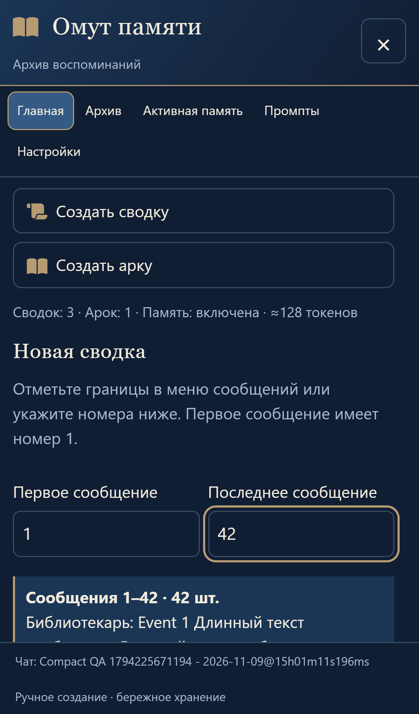
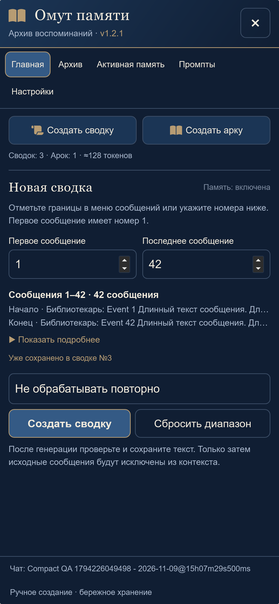
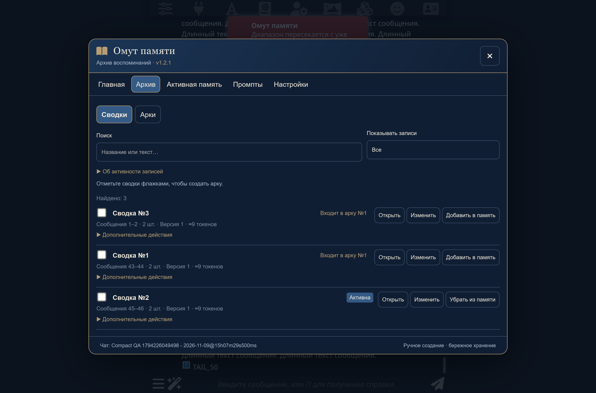

# Компактный интерфейс 1.2.1

9 ноября 2026 года. Пользователь подтвердил внесение ТЗ «текст (2).txt» поверх 1.2.0 и публикацию в существующем репозитории.

## Что исправлено

Прежний `home()` продолжал создавать вертикальные крупные кнопки, старую структуру формы и предпросмотр из двух фрагментов по 200 символов. Архив использовал фоновые `.pv-card`. Номера версии в окне не было. Изменение только размеров кнопок не устраняло эту структуру.

В 1.2.1 главная строится заново из компактных UI-компонентов: две кнопки рядом, одна строка количества сводок/арок/токенов, отдельный небольшой заголовок диапазона и состояние памяти. Пояснения сохранены. Форма, выбор границ и обработчик генерации остаются связанными с прежними функциями.

Предпросмотр показывает строку `Сообщения 1–42 · 42 сообщения` и короткие однострочные фрагменты начала/конца. «Показать подробнее» раскрывает **весь выбранный диапазон**, включая полный текст каждого сообщения. Его DOM строится только при раскрытии, содержимое прокручивается отдельно. При изменении диапазона старый предпросмотр удаляется. Для одного сообщения фрагмент не дублируется.

Совпадение с архивом подписано «Уже сохранено в сводке №3»; несколько совпадений — с коротким количеством остальных. Полные названия сохраняются в прежнем выборе повторной обработки. Существующие блокировка, разрешение версии, замена и подтверждение не изменены.

Архив и активная память используют семантические строки `.pv-entry-row` с прозрачным фоном и тонким нижним разделителем. Название, номер, статус, диапазон, версия и токены доступны сразу; на компьютере основные действия стоят справа, на телефоне — компактным рядом ниже. Все второстепенные действия и технические пояснения доступны в «Дополнительных действиях». Поиск, фильтры, выбор для арки, порядок и статусы сохранены. Описание фильтра раскрывается через «Об активности записей».

В заголовке отображается **v1.2.1**. Значение берётся из экспортированного `UI_VERSION` в реально загруженном `src/ui.js`, а не из отдельного manifest. Если в кеше остался прежний HTML-шаблон, UI находит старую подпись и добавляет версию без ошибки загрузки. `npm run check` сверяет UI_VERSION, package и manifest.

## Проверка фактического применения

Проверялся работающий DOM и computed styles в отдельной **SillyTavern 1.19.0**, не только текст CSS. Новый `tests/compact-ui.mjs` сначала воспроизвёл отсутствие номера версии, затем прошёл после изменения структуры.

- **67/67 unit-тестов**, синтаксис семи JS-модулей и согласованность трёх версий.
- Новый UI-тест в **Chromium и WebKit**: сообщения длиной более 2000 символов, диапазон 42 сообщения, короткие фрагменты, ленивое раскрытие всех сообщений, буквальный текст, сворачивание, один/обратный/изменённый диапазон, несколько совпадений, блокировка повторного запроса до обращения к модели.
- Измерены две кнопки в одном ряду высотой 36–44 px, строка счётчиков не выше 24 px и закрытый предпросмотр не выше 150 px на ширинах 320/390/430/1280. Проверены прозрачные строки архива, отсутствие старых `.pv-card`, высота стандартной мобильной записи до 155 px, открытие полного текста и доступность технических действий.
- Проверены короткий экран 390×420, прокрутка, доступная X, отсутствие горизонтального переполнения, сохранение границ после закрытия/открытия, неизменность полного JSON архива и обоих промптов.
- Отдельный прогон Chromium с принудительно прежним HTML-шаблоном успешно проверил совместимость кеша.
- `manager-ui.mjs`, WebKit: иконки сообщений, поиск/фильтр, выбор, ручной порядок арки в реальном запросе, отсутствие дублей, перезагрузка и сохранность архива/промптов.
- `ui-memory.mjs`, WebKit: фактические статусы, немедленная активация/деактивация, отключение, лимит, диапазон и данные после перезагрузки.
- `settings-interactions.mjs`, WebKit: сворачивание, сохранение состояния, 18 касаний по шести кнопкам, один переход на касание, правильная вкладка, X и возврат управления ST.
- `integration.mjs`, Chromium: создание сводки, редактирование, подтверждение, серверное чтение, Hide, арка, обычный запрос без дублей, лимит, импорт промпта, перезагрузка, чаты/ветки/группа, ошибка модели, прерванное сохранение, журнал, восстановление и JSON merge.

Снимки до/после просмотрены. Независимое ревью не обнаружило значимых замечаний. В отдельной тестовой установке нет необработанных ошибок страницы. Ответ модели в интеграционных проверках имитировался на границе HTTP; приложение ST, события, токенизаторы, сохранение и Hide настоящие. WebKit запускается с параметрами iPhone 13; физический iPhone и его клавиатура не проверялись. В Windows WebKit-фикстуре отключён встроенный TTS из-за отсутствия Web Speech API, ошибки не подавляются.

## Сохранность

`src/core.js`, `src/engine.js`, `src/host.js`, `src/order.js`, `src/view-state.js` и `index.js` **не изменены относительно v1.2.0**. Нет миграций, очистки архива, изменений промптов или фоновых запросов модели. Пользовательская личная установка и её данные не изменялись. Сохраняется штатный JSON-экспорт и тег v1.2.0 для отката кода.

## Снимки

| Главная 1.2.0 | Главная 1.2.1 |
|---|---|
|  |  |



## Повторение

Только отдельная тестовая ST: скрипт создаёт синтетические данные и настраивает тестовое подключение.

```sh
npm test
npm run check
node tests/compact-ui.mjs /path/to/playwright/index.mjs chromium http://127.0.0.1:18273
node tests/compact-ui.mjs /path/to/playwright/index.mjs webkit http://127.0.0.1:18273
node tests/compact-ui.mjs /path/to/playwright/index.mjs chromium http://127.0.0.1:18273 legacy-template
```
