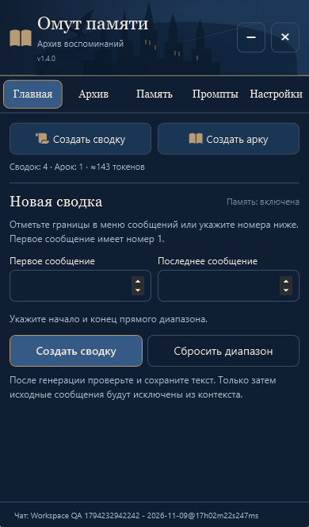
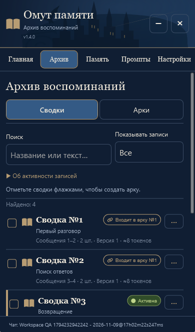
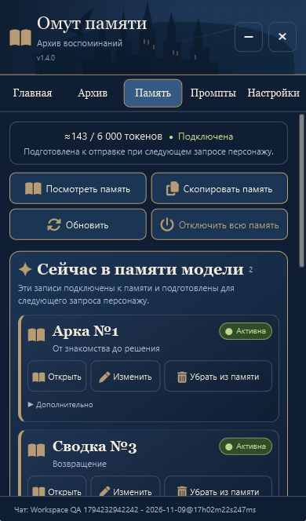
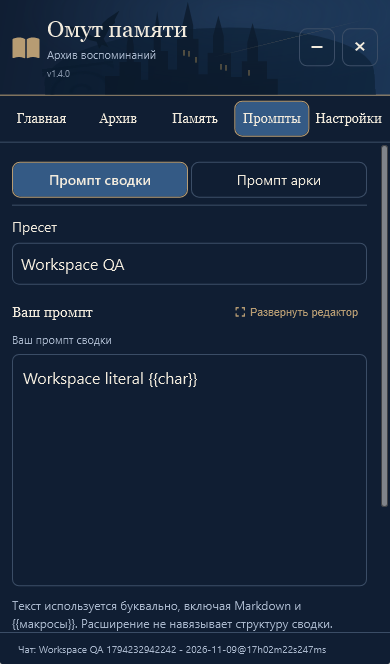
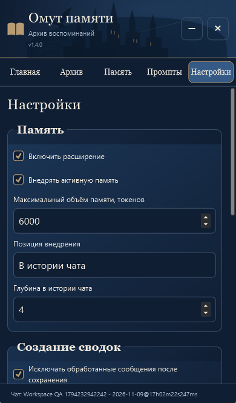
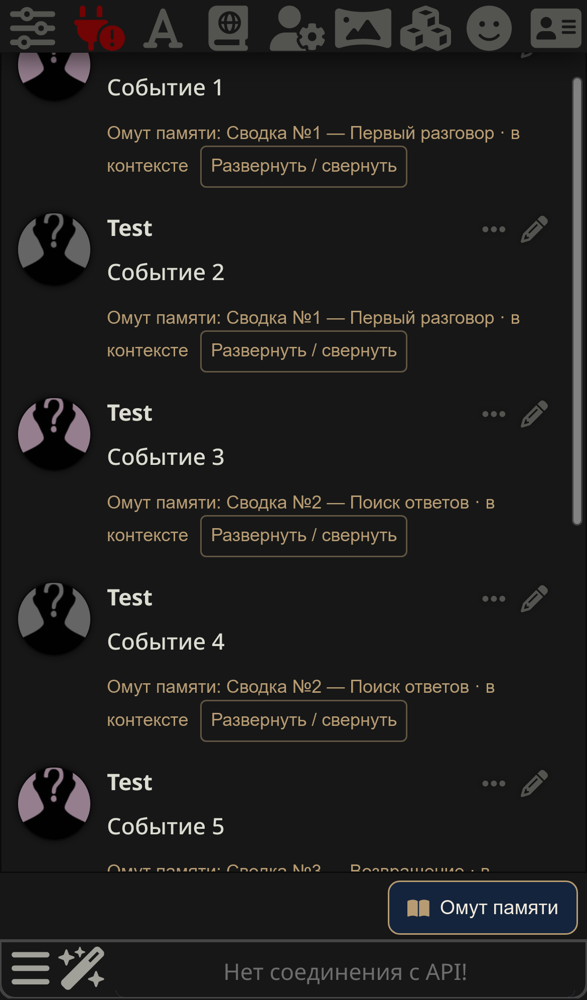

# Согласованный интерфейс v1.4.0

Обновление существующей версии 1.3.0 по «текст 2.txt», изображению пользователя и одобренному интерактивному макету. Пользователь подтвердил внедрение 9 ноября 2026 года.

## Что изменено

- Все пять вкладок используют общую сине-бронзовую палитру, книжные заголовки и компактные элементы. Шапка содержит лёгкие CSS-силуэты замка, орла и моста, без внешних загрузок; декор не перехватывает касания. Светлая тема сохранена.
- Текстовые вкладки помещаются в одну строку. На телефоне «Активная память» сокращается до «Память», полное доступное название сохранено.
- Состояние памяти показывает действительные токены и подключение; пояснение явно говорит о подготовке к следующему запросу. Это не подтверждение уже состоявшейся отправки. Просмотр, копирование, выключение, обновление и лимит работают через прежние функции.
- Две группы записей имеют отдельные рамки. Карточки компактные, с бронзовой полосой и овальными метками. Метаданные доступны в окне записи; остальные технические действия — в раскрывающемся разделе. Три основные кнопки включают кликабельные иконки.
- Архив показывает компактные строки, поиск по названию/тексту, фильтр, выбор сводок и меню ··· со всеми прежними действиями. Нажатие статуса связи открывает настоящую родительскую арку. Самим аркам этот статус не присваивается.
- Главная сохраняет компактный выбор диапазона, статистику, защиту повторного диапазона и полный предпросмотр по раскрытию. Выбор границ в чате окно не открывает.
- Промпты сохраняют независимые тексты, пресеты, версии, импорт и экспорт. Поле можно развернуть на доступную высоту. Возврат из большого редактора переносит текст в черновик; автоматического сохранения или изменения инструкций нет.
- Настройки собраны в четыре группы: «Память», «Создание сводок», «Архив», «Интерфейс». Восстановление находится внутри раскрывающегося раздела архива. Полезные пояснения и функции сохранены; новые настройки движка не добавлены.

## Сворачивание и закрытие

Кнопка − закрывает нативный диалог, освобождая верхний слой браузера, но сохраняет его DOM. Черновик, выбор пресета, вкладка и прокрутка не пересоздаются. Над штатной формой отправки появляется одна кнопка восстановления в обычном потоке разметки; она не перекрывает поле ввода или отправку. Повторный вход через штатные кнопки также убирает её.

Кнопка × и Escape полностью закрывают окно. Быстрого восстановления после этого нет, остаётся обычный вход расширения. Состояние окна не переносится через перезагрузку, архив переносится как прежде. Если чат сменился при свёрнутом окне, при восстановлении списки перестраиваются по новой сессии; записи предыдущей истории не остаются доступны для действий. Глобальный черновик промпта при этом сохраняется.

Вложенные окна имеют отдельный ×. Он использует прежнее событие отмены, поэтому окно текущей генерации отменяет запрос так же, как Escape. Закрытие расширения и его сворачивание не отключают внедрение памяти.

## Сохранность и границы

`src/core.js`, `src/engine.js`, `src/host.js`, `src/order.js`, `src/view-state.js` и `index.js` побайтно не изменены относительно v1.3.0. Формат архива, пользовательские тексты/промпты, связи, хронология, механизмы генерации, Hide, восстановления и внедрения прежние. Миграция, очистка или пересохранение пользовательского архива при обновлении не выполняются.

На синтетическом архиве проверено полное совпадение JSON до и после просмотра, сворачивания и глобального выключения; после перезагрузки сохранены записи, связи и промпты. Личная установка и личные чаты пользователя не открывались. Неподтверждённые черновики сохраняются при сворачивании в текущей странице, но не обещается их восстановление после перезагрузки браузера.

## Проверки

Отдельная SillyTavern 1.19.0, Node.js 24.16.0, Chromium/Edge и Windows WebKit с параметрами iPhone 13. Ответ модели имитируется только на границе HTTP; DOM, сохранение, токенизаторы, построение запросов и Hide настоящие.

- 69 unit-тестов; проверка семи JS-модулей и одинаковой версии package/manifest/UI.
- `reference-ui.mjs`: многократные сворачивание/возврат, тот же узел и несохранённый текст редактора, прежняя вкладка, неизменные настройки/память, доступный чат, один элемент восстановления без перекрытия, отдельное закрытие, большой редактор, доступное название и навигация на 320/390/736/1280 px, отмена через ×.
- `reference-regressions.mjs`: возврат во время задержанного `/api/chats/get` до события смены чата; быстрый возврат и большой редактор при отложенном обновлении; сохранение способа повторной обработки, предпросмотра и меню; независимые ссылки на несколько неактивных родительских арок; пустой блок памяти; очень длинные заголовки на экране 320×420.
- `memory-workspace.mjs`: все пять вкладок, меню архива и касание иконки, переход к родительской арке, точный блок просмотра/копирования, реальные статусы, активация/деактивация, глобальный переключатель, лимит, отсутствие дублей, смена чата при свёрнутом окне, возврат прежнего блока, перезагрузка и неизменность данных.
- `manager-ui.mjs`: компактные кнопки границ, поиск/фильтр, выбор, исходная и ручная хронология арки в реальном запросе, сохранность после перезагрузки.
- `ui-memory.mjs`: границы без всплывающего окна, независимый выбор для арки, реальные статусы и внедрение, отключение, лимит и сохранение диапазона.
- `settings-interactions.mjs`: сворачивание штатного раздела, сохранение состояния, 18 касаний иконки/текста/края шести кнопок, правильные вкладки, единственное открытие, × и доступность SillyTavern.
- `compact-ui.mjs`: совместимость прежнего HTML-шаблона, компактная главная и архив, полный предпросмотр по требованию, пересечения, блокировка повторного запроса, поиск, выбор и действия.
- `integration.mjs`: сводка → правка → сохранение → проверка сервера → Hide; арка и обычный ответ без дублей; независимые WI/Summarize; лимит; импорт промпта; сохранение после перезагрузки; изоляция чатов/веток/групп; ошибка модели; прерванная запись, журнал, восстановление и импорт JSON.

Новые сценарии сворачивания, большого редактора, доступного мобильного названия и отмены сначала воспроизвели отсутствие поведения, затем прошли. В браузерных сценариях нет необработанных ошибок страницы. Физический iPhone и его экранная клавиатура не использовались; проверены WebKit, касания, прокрутка, safe-area и короткое окно.

Независимое ревью выявило гонки восстановления/обновления, потерю состояния формы, неполные связи с неактивными арками, подпись пустого блока и ограничение длинного заголовка. Все замечания воспроизведены браузерными проверками и исправлены одним проходом. Полный набор регрессий прошёл в Chromium и WebKit. Отложенных замечаний нет.

## Реальные мобильные снимки

Тестовые тексты и значения токенов на снимках синтетические.

### Главная



### Архив



### Активная память



### Промпты



### Настройки



### Свёрнутое окно



## Повторение

Только отдельная тестовая установка: сценарии создают синтетические чаты и изменяют её настройки.

```sh
npm test
npm run check
node tests/reference-ui.mjs /path/to/playwright/index.mjs chromium http://127.0.0.1:18274
node tests/memory-workspace.mjs /path/to/playwright/index.mjs webkit http://127.0.0.1:18274
node tests/reference-regressions.mjs /path/to/playwright/index.mjs webkit http://127.0.0.1:18274
node tests/integration.mjs /path/to/playwright/index.mjs http://127.0.0.1:18274
```
