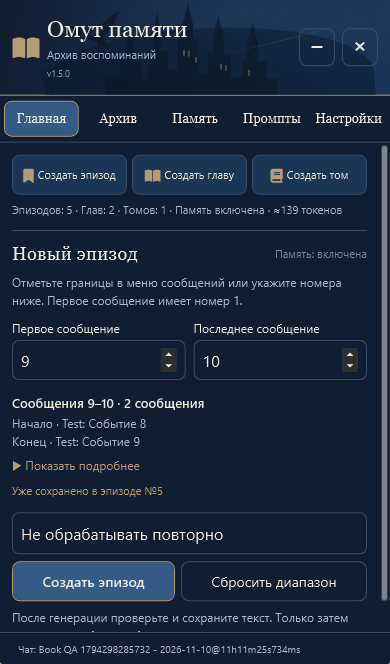
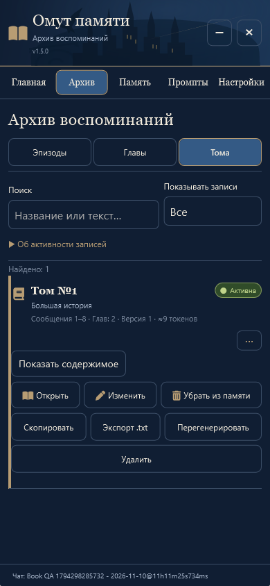
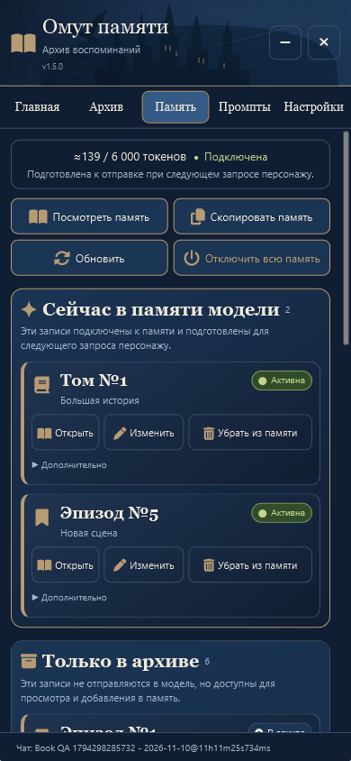
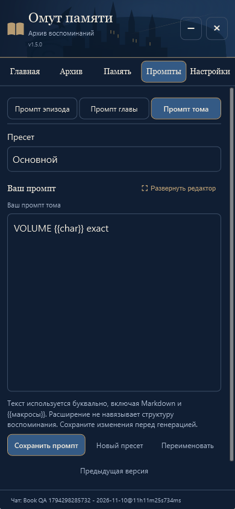
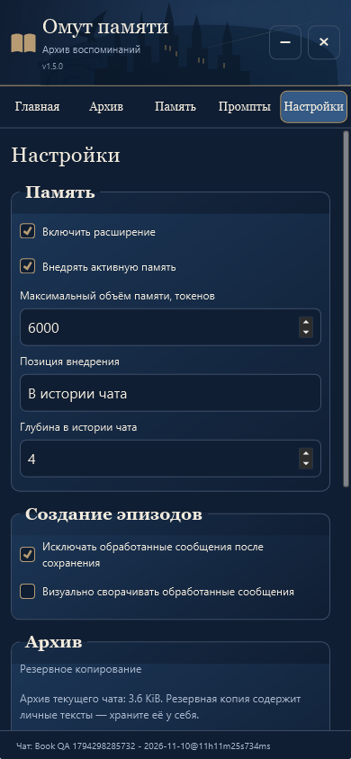

# «Эпизод → Глава → Том» · v1.5.0

Обновление поверх v1.4.0 по «текст (4).txt» и изображению бронзовых закладок. Пользователь подтвердил внедрение и публикацию 10 ноября 2026 года.

## Три ручных уровня

Эпизод создаётся из сообщений, глава — минимум из двух эпизодов, том — минимум из двух глав. Все действия запускаются вручную через существующее подключение ST. Автоматически выполняется только подготовка выбранной памяти к следующему запросу персонажу.

На главной три компактные кнопки и статистика. В архиве три раздела с независимым выбором источников для главы и тома. Список показывает исходные диапазоны, токены и ручной порядок. Сначала предлагается хронология исходных сообщений; стрелки позволяют задать нелинейную последовательность. Даты внутри пользовательских текстов не меняются, сюжетные даты не придумываются.

Генерация тома использует тот же путь буквального запроса, ограничения контекста, предварительного редактирования, сохранения и серверной проверки, что прежняя генерация объединённых записей. Том не вызывает Hide; исходные сообщения скрываются только существующей операцией подтверждённого эпизода. Для тома действует прежний журнал незавершённого сохранения.

В «Промптах» три независимых набора пресетов, версий и редакторов. Промпт тома добавляется только при отсутствии этого ключа; пустой или пользовательский текст не заменяется стандартным. Старые копии JSON с двумя промптами сохраняют текущий третий набор. Новый экспорт содержит все три.

## Совместимость и сохранность

Внутренние типы `summary` и `arc`, ключи промптов и поля `summaryIds` сохранены. Старый заголовок «Сводка №7» отображается как «Эпизод №7», «Арка №9» — как «Глава №9», но сохранённые заголовки не переписываются. Исходное название доступно в поле записи. Поиск учитывает и сохранённый, и отображаемый заголовок.

Добавлен тип `volume` с `chapterIds`; старым записям новое поле не приписывается. Контейнер архива и экспорта остаётся версии 1. Валидатор принимает прежние записи, проверяет новые ссылки по уровню и отклоняет отсутствующие, повторные и циклические связи. При объединении архивов переназначаются связи всех уровней, исходные записи получателя сохраняются.

Никакой массовой миграции архива, удаления, клонирования старых записей или подстановки инструкций в старые промпты при загрузке нет. `src/host.js` и `index.js` не изменены относительно v1.4.0. Механизм буквальных запросов, серверной записи/проверки и владения Hide сохранён; core/engine расширены только для новой иерархии и проверок безопасных действий.

Сохранность проверялась на синтетических старых записях и пресетах: ID, заголовки, полные тексты, диапазоны, история и два прежних набора промптов совпадают до и после ручной работы и перезагрузки. Личная установка пользователя и его архивы не открывались.

## Фактическая память и связи

Активный том заменяет его главы и вложенные эпизоды независимо от скрытых флагов промежуточных записей. Несвязанные новые эпизоды остаются в общей хронологической последовательности вместе с томом. Пересечение нескольких активных родителей по записям или исходным сообщениям блокирует весь блок с пояснением.

Основные метки «Активна» и «В архиве» отражают допустимый снимок движка. Связи с главами и томами показываются отдельно для активных и неактивных родителей. Косвенные связи доступны в подробностях. Родительская запись открывается по её метке, источники — через «Показать содержимое» с переходом Том → Глава → Эпизод. Просмотр не восстанавливает версии и не снимает отметку проверки; изменения доступны только в редакторе.

При явном включении/выключении тома его потомки остаются деактивированными и не возвращаются в память автоматически. Удаление активного тома также очищает латентные флаги, которые могли появиться после перегенерации главы. При удалении неактивного тома отдельный ручной выбор глав сохраняется. Дочерние записи не удаляются.

Правка источника помечает всех предков для проверки без автоматического переписывания. Удаление связанного ребёнка требует отдельного предупреждения и подтверждения отвязывания. Оно разрешено, если у каждого родителя останется минимум два источника; родительский текст сохраняется, родители и предки отмечаются для проверки. Если останется меньше двух источников, операция защищена с объяснением: сначала нужно пересобрать либо удалить родителя. Это явное ограничение сохраняет валидность иерархии. Для эпизодов остаётся прежнее условие восстановления собственных Hide-исключений перед удалением.

Автоматические номера новых записей учитывают уже занятые номера, а не только количество записей. Существующие пользовательские номера не перенумеровываются.

## Две закладки

Начало эпизода — тонкая бронзовая закладка с восьмиконечной звездой; конец — с галочкой. SVG 20×20, цвет `#B79C73`, прозрачный фон, область нажатия 32–36 px. Декоративная овальная рамка референса в панель сообщений не переносилась.

Обе кнопки имеют названия для экранного диктора и подсказки. Выбор сохраняет границу, уведомление и выделение; окно не открывается. Обратный диапазон даёт предупреждение. Повторный выбор меняет нужную границу, остальные кнопки ST сохраняются.

## Защита смены чата

Сохранены проверки восстановления свёрнутого окна во время задержанного запроса чата и сохранения черновиков/раскрытых элементов. Добавлена явная привязка к исходному сеансу для импорта архива, подтверждений удаления/восстановления версии и массового восстановления. После асинхронных подтверждений и перед записью сеанс проверяется повторно. Смена чата закрывает вложенные окна, относящиеся к нему.

## Проверки

Отдельная SillyTavern **1.19.0**, Node.js **24.16.0**, Chromium/Edge и Windows WebKit с параметрами iPhone 13. Ответ модели имитируется на границе HTTP; DOM, сборка запроса, токенизация, сохранение, чтение с сервера и штатный Hide настоящие.

- **90/90 Node-тестов**, проверка восьми JS-модулей и совпадения UI/package/manifest.
- `hierarchy.test.js`: рекурсивное подавление, том с новым эпизодом, пересечение родителей, хронология, импорт/экспорт/переназначение связей, транзитивная проверка, поиск нового названия и неизменность старых данных.
- `engine.test.js`: все прежние сценарии плюс три независимых промпта, идемпотентное добавление третьего, точный порядок глав в запросе, предварительный просмотр без сохранения, неподтверждённая запись и восстановление, смена чата, устаревшие источники, включение/выключение/удаление томов, латентные флаги, подтверждённое отвязывание и номера.
- `book-hierarchy.mjs`, Chromium и WebKit: ручное создание двух глав, тома и последующего эпизода; отдельные буквальные промпты; ручной порядок; переход к исходникам; старый JSON промптов и экспорт всех трёх; реальный обычный запрос персонажа с томом и новым эпизодом без дочерних дублей; сохранность старых записей/промптов/диапазонов/истории после перезагрузки; новые закладки и предупреждение обратного диапазона; все пять вкладок на 320/390/736 px.
- `book-safety.mjs`, Chromium и WebKit: режим чтения не меняет версию/отметку; подтверждение восстановления версии не меняет другой чат; импорт и массовое восстановление после смены чата не изменяют новый архив/сообщения. В WebKit дополнительно выполнено подтверждённое отвязывание главы с сохранением текста тома, двух оставшихся глав и всех шести эпизодов.
- `reference-regressions.mjs`, WebKit: тот же DOM черновика при сворачивании, большой редактор, быстрый возврат, фоновые события, отложенная загрузка другого чата, сохранение выбора повторной обработки/предпросмотра/меню, связанные родители, пустой блок, длинные заголовки, короткие окна.
- `manager-ui.mjs`, `ui-memory.mjs`, Chromium: прежние действия, поиск/фильтры, исходная и ручная хронология, статусы, независимый выбор, диапазон без автопоказа, лимит и перезагрузка.
- `settings-interactions.mjs`, WebKit: 21 касание по иконке, тексту и свободному месту семи кнопок, правильные вкладки, одно открытие, сохранение сворачивания штатного раздела, закрытие и доступность ST.
- `compact-ui.mjs`, WebKit: прежний кеш шаблона, компактная главная с тремя действиями, полный предпросмотр по запросу, защита повторного диапазона, архив и короткий экран.
- `integration.mjs`, Chromium: сводный сценарий генерации/редактирования/подтверждения/Hide, обычный ответ без дублей, независимые WI/Summarize, лимит, промпты и перезагрузка, чаты/ветки/группы, ошибка модели, прерванная запись и восстановление, объединение JSON.

Замечания независимого ревью воспроизведены тестами и исправлены одним проходом: чужой чат при импорте/восстановлении, латентная активация при удалении тома, действия изменения в режиме чтения, связанное удаление, коллизии номеров и поиск нового названия. Отложенных замечаний нет. Необработанных ошибок страницы в завершённых сценариях нет.

Физический iPhone, экранная клавиатура и художественное качество реального ответа выбранной модели отдельно не проверялись. Локальные проверки не используют пользовательские ключи.

## Реальные мобильные снимки

Содержимое и значения на снимках синтетические.

### Главная



### Архив



### Активная память



### Промпты



### Настройки



## Повторение

Только отдельная тестовая установка: сценарии создают синтетические данные и изменяют её настройки.

```sh
npm test
npm run check
node tests/book-hierarchy.mjs /path/to/playwright/index.mjs chromium http://127.0.0.1:18275
node tests/book-hierarchy.mjs /path/to/playwright/index.mjs webkit http://127.0.0.1:18275
node tests/book-safety.mjs /path/to/playwright/index.mjs webkit http://127.0.0.1:18275 import
node tests/book-safety.mjs /path/to/playwright/index.mjs webkit http://127.0.0.1:18275 restore
node tests/book-safety.mjs /path/to/playwright/index.mjs webkit http://127.0.0.1:18275 unlink
node tests/reference-regressions.mjs /path/to/playwright/index.mjs webkit http://127.0.0.1:18275
```
