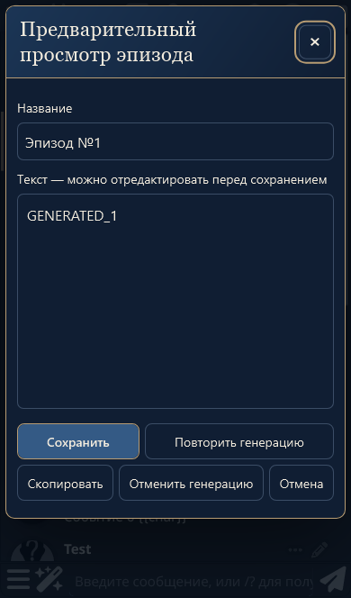
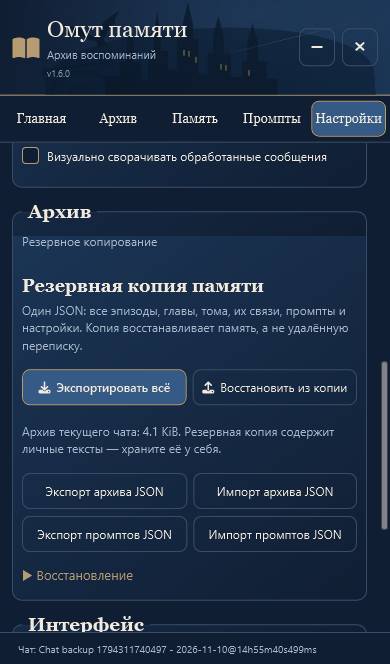
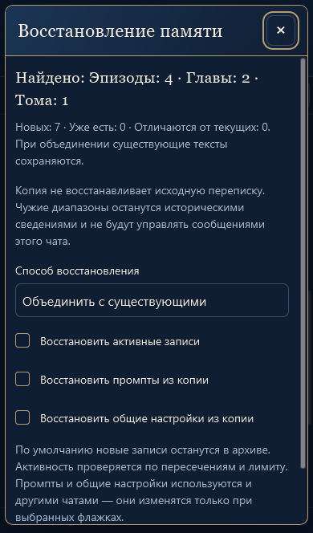

# «Омут памяти» · v1.6.0

Обновление поверх v1.5.0 по «текст (5).txt» и изображению трёх бронзовых иконок. Внедрение и публикация подтверждены пользователем. Генерация остаётся ручной, прежние три уровня, тексты, связи и промпты сохраняются.

## Создание в чате

Две закладки выбирают начало и конец, не открывая главное окно. Только у корректного конца появляется книга с плюсом. Это семантическая кнопка с одним click-обработчиком; SVG не перехватывает касания. Подписи и общая овальная рамка в чате отсутствуют. Соседние кнопки SillyTavern не меняются.

Книга запускает прежнюю генерацию эпизода, показывает компактный индикатор в сообщении и затем предпросмотр поверх чата. Можно изменить название и текст, повторить генерацию, сохранить или отменить. До сохранения архив и память не меняются. При ошибке и отмене диапазон сохраняется; успешное сохранение очищает только границы этого черновика, сохраняя более новый выбор.

В «Настройки → Создание эпизодов» добавлен включённый по умолчанию переключатель предпросмотра. При выключении успешный ответ ручной генерации сохраняется сразу, без второго подтверждения и открытия главного окна. Для глав и томов просмотр перед сохранением остаётся. Прежняя форма выбора диапазона на главной сохранена.

Повторные нажатия не запускают второй запрос или сохранение. Даже при сбое последнего чтения с сервера повторная попытка того же черновика проверяет одну существующую запись. Исходники исключаются только прежним механизмом после подтверждения первичной записи.

Нижний вход остаётся в меню у поля ввода: синий `#172C49`, бронза `#B79C73`, светлый текст `#F2EBDD` и подпись `#A9B7CC`. Минимизированное окно восстанавливается прежней отдельной кнопкой, не перекрывая поле ввода.

## Полная копия

«Настройки → Архив → Резервная копия памяти» содержит две основные кнопки. Экспорт скачивает один UTF-8 JSON `Omut_Pamyati_YYYY-MM-DD.json` формата `pensieve-backup`, версия 1. В нём все активные и архивные записи, дочерние записи, тексты и история версий, порядок, диапазоны, связи, исходные флаги активности, три группы пресетов промптов и настройки расширения. Сообщений чата, ключей API и сторонних облачных обращений нет.

Восстановление использует системный выбор файла. Целиком проверяются формат, записи, вложенная история, связи, происхождение, промпты и настройки. Затем показаны количество записей и способ восстановления. Объединение распознаёт записи по происхождению и исходному ID: повторный импорт не плодит копии, существующие изменённые тексты сохраняются. При коллизии ID разных источников переназначаются все связи. Ошибка размера или несовместимость объединения не закрывает доступ к проверке режима замены.

По умолчанию новые записи неактивны; текущие промпты и общие настройки сохраняются. Три флажка позволяют отдельно вернуть эффективную активность, промпты и настройки. Замена архива требует отдельного подтверждения и предлагает сначала экспортировать текущие записи. Собственные исключения сообщений перед заменой нужно восстановить.

## Защита данных и источников

- Источник копии и ID записи сохраняются при дальнейших переносах. Чужие и неизвестные источники не привязываются к сообщениям получателя даже при совпадении UUID. Включены старые записи `imported:true` из v1.5 без происхождения. Их исторические диапазоны доступны для чтения, но не управляют Hide, сворачиванием или метками сообщений.
- Эпизод без доступных собственных исходников нельзя перегенерировать или использовать для восстановления чужих сообщений. Главы и тома пересобираются по сохранённым дочерним текстам.
- Активируются эффективные родительские записи без дочерних дублей, после проверки памяти и лимита. Видимые исходники блокируют дублирование: проверяются UUID и контрольные суммы, а для переписки без UUID — совпадение последовательности целого эпизода. Контрольные суммы используются только для проверки, не для привязки источников.
- Сохраняется и проверяется целый архив. До проверки выбранных общих разделов журнал восстановления остаётся на сервере, внедрение заблокировано. Промпты и настройки проверяются чтением после прямого штатного сохранения ST; ожидание debounce не считается подтверждением.
- При ошибке возвращаются прежние локальные данные и выполняется безопасная попытка отката в исходном чате. Неподтверждённый откат обозначается явно. Новые правки пользователя не перезаписываются поздним откатом. Смена чата не записывает архив или откат в другую историю.
- Незавершённую копию можно завершить либо оставить в архиве без активности. Второй вариант сохраняет восстановленные тексты, отключает все записи и возвращает выбранные общие разделы из журнала. После подтверждённой замены он не возвращает прежний архив. Старые активные ID не применяются к чужим записям с такими же ID.
- Во время запуска восстановления X, Escape, отмена и повторные действия блокируются до результата; до запуска отмена доступна. Смена чата по-прежнему принудительно прерывает исходный сеанс.

Копия возвращает память, а не оригинальную переписку. Для полного текста чата нужен отдельный штатный экспорт SillyTavern. Архив хранится в метаданных конкретного чата, промпты и настройки — в штатных общих настройках. Внешняя база данных не добавлена.

## Проверки

- `npm test`: **121/121**, включая 11 новых проверок по итогам независимого обзора.
- `npm run check`: **9 JS-модулей**, версия интерфейса, package и manifest совпадают.
- Новые браузерные сценарии в Chromium/Edge и WebKit с профилем iPhone 13: условная третья иконка, касание SVG, отмена/редактирование/перегенерация, двойное нажатие, успешное сохранение без предпросмотра, ошибка модели с сохранением диапазона, полный файл и повторный импорт, испорченный JSON, UUID чужих источников, явная активация и перезагрузка.
- Реальная запись общих разделов ST: отказ `/api/settings/save` возвращает прежнее состояние, успешная запись подтверждается `/api/settings/get` и сохраняется после перезагрузки.
- Отдельные регрессии: два архива по 12 MiB допускают замену при недоступном объединении, X/отмена/Escape не скрывают выполняющуюся операцию, старый импорт v1.5 не помечает и не сворачивает чужие сообщения.
- Прежние сценарии трёх уровней, буквальных промптов, содержимого, активной памяти, лимитов, сворачивания/закрытия, кнопок настроек и переключения чатов проверены на одноразовой ST 1.19.0. HTTP-ответ модели синтетический, остальные слои ST настоящие.

Снимки сделаны из работающего расширения на синтетических данных. Физический iPhone, его клавиатура и системное приложение «Файлы» отдельно не проверялись: WebKit-эмуляция не подтверждает все особенности устройства.
