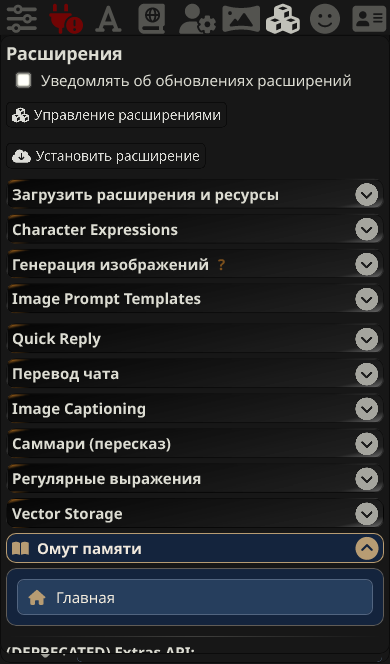

# Компактный вход · v1.6.1

Обновление по «текст (6).txt» поверх v1.6.0. Пользователь подтвердил немедленное внедрение и публикацию.

В штатном раскрывающемся разделе остаётся только **«Омут памяти → Главная»**. Семь прежних отдельных действий удалены из регистрации. Заголовок и штатное сворачивание, сохранение раскрытого состояния и независимость соседних разделов сохранены. Внутри нет дополнительных описаний или разделителей.

Кнопка с домиком использует фон `#263E5D`, рамку `#526580`, текст `#F2EBDD` и бронзовую иконку `#B79C73`. Минимальная высота 36 px, CSS ограничен прежним контейнером Pensieve. Иконка, надпись и свободное место вызывают одно действие.

Нажатие использует прежний `UI.open('home')`: закрытое окно открывается, свёрнутое восстанавливается на главной вкладке, открытое переводится на неё без второго экземпляра. Повторная регистрация раздела не добавляет кнопок или обработчиков.

Пять основных вкладок, создание эпизодов/глав/томов, архив, активная память, промпты, настройки и резервные копии остаются в существующем окне. Нижний быстрый вход и три иконки у сообщений не изменены. Код генерации, хранения, восстановления, внедрения и источников остался идентичен v1.6.0.

## Проверки

- Браузерный тест сначала воспроизвёл несоответствие: семь кнопок вместо одной; после изменения прошёл.
- В Chromium/Edge и WebKit с профилем iPhone проверены нажатия на иконку, текст и отступ, переключение на главную из открытого/свёрнутого окна, один экземпляр окна, повторная регистрация без дубликатов, сворачивание и сохранение его состояния, доступность соседнего штатного раздела и неизменность архива/промптов/общих настроек.
- Проверены работа кнопок создания в чате с обоими режимами предпросмотра, три уровня памяти, основные вкладки и полный JSON-экспорт/восстановление через единый вход.
- `npm test`: **121/121**. `npm run check`: **9 модулей**, версии UI/package/manifest совпадают.

Использована одноразовая SillyTavern 1.19.0 с синтетическими данными и ответами модели. Физический iPhone отдельно не тестировался; проверка выполнена в WebKit-эмуляции.
