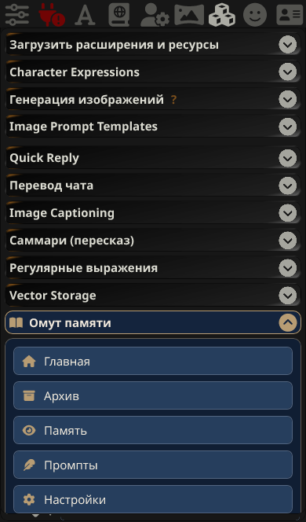
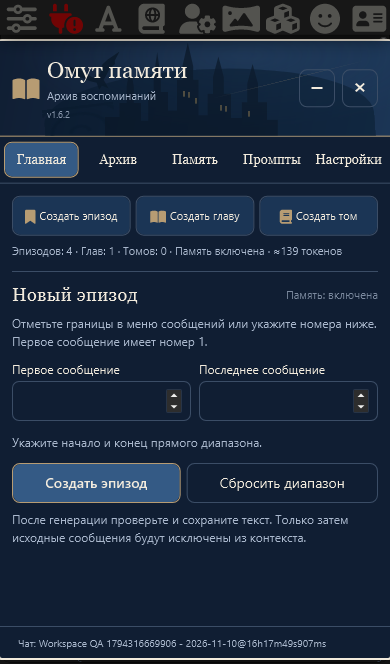

# Пять пунктов навигации · v1.6.2

Изменение по «текст (7).txt» и приложенному референсу поверх v1.6.1, с продолжением выбранного пользователем режима немедленного внедрения и публикации.

Раскрывающийся раздел содержит ровно пять кнопок в заданном порядке:

| Меню | Существующая вкладка | Иконка |
|---|---|---|
| Главная | Главная | Домик |
| Архив | Архив | Архивная коробка |
| Память | Память | Глаз |
| Промпты | Промпты | Перо |
| Настройки | Настройки | Шестерёнка |

Каждый пункт напрямую вызывает прежний `UI.open(tab)`, без промежуточной главной страницы. Окно всегда одно: закрытое открывается на выбранной вкладке, открытое переключается, свёрнутое восстанавливается. Повторное нажатие текущей вкладки в меню и в основном окне сохраняет DOM редактора, курсор и выделение, в том числе после смены чата для общих промптов. Общие настройки без открытого чата также не пересоздаются при повторном выборе. Заголовок, штатное сворачивание, запоминание состояния, нижний вход и защита одновременной регистрации сохранены.

Чтобы меню можно было нажимать при уже открытом окне, основное окно не блокирует остальной интерфейс и располагается под штатной верхней панелью ST. Меню расширений открывается поверх него; выбор пункта закрывает эту штатную панель и показывает выбранную вкладку. Основное окно закрывается крестиком или Escape, сворачивается прежней кнопкой. Редакторы, предпросмотры и подтверждения остаются модальными.

Фон кнопок `#263E5D`, раскрытого раздела `#101E33`, иконок `#B79C73`, текста `#F2EBDD`, границ `#526580`. Кнопки имеют одинаковую высоту и отступы; стили ограничены контейнером Pensieve. Чужие разделы не оформляются расширением.

Действия создания эпизода, главы и тома остаются внутри главного окна; три иконки у сообщений работают независимо от меню. Набор основных вкладок не меняется. Видимая и доступная подпись вкладки памяти согласована с меню: «Память», внутренний идентификатор `memory` прежний.

## Несохранённый ввод

В текущей странице удерживаются отдельные черновики промптов по уровню и пресету. Переходы по меню/основным вкладкам и повторное открытие не записывают этот текст в настройки. «Сохранить промпт» остаётся единственным подтверждением. Явный отказ от изменений при смене пресета удаляет черновик. Если сохранённый текст заменён, например импортом, устаревший черновик не подменяет новую версию. После сохранения последующее редактирование получает правильную новую исходную версию. Подтверждённое восстановление предыдущей версии заменяет текущий черновик даже при совпадении сохранённых версий. При перезагрузке страницы несохранённые черновики не сохраняются.

Диапазон эпизода, выбор источников и поиск продолжают использовать прежнее состояние интерфейса. Код хранения, генерации, иерархии, внедрения, резервных копий, статусов и исходных сообщений не изменён.

## Проверки

- RED: старая версия показывала один пункт вместо пяти и теряла несохранённый промпт после перехода на главную. После изменений оба сценария проходят.
- Chromium/Edge и WebKit с профилем iPhone: все 15 вариантов касания (иконка/текст/отступ), прямые вкладки из закрытого, открытого и свёрнутого состояния, отсутствие второго окна, штатное сворачивание и неизменность данных.
- Три промпта: переходы с черновиками, повторная текущая вкладка, подтверждённый отказ от изменений, изменение сохранённой версии извне и новый черновик после сохранения. Отдельно проверены реальные касания меню при открытом окне, сохранение узла/выделения редактора, событие смены чата, общие настройки без чата и восстановление совпадающей исторической версии.
- Сохранены проверки одновременной регистрации одного раздела, мобильной ширины и клавиатуры, создания в чате с обоими режимами предпросмотра, иерархии, активной памяти и полного JSON-восстановления.
- `npm test`: **121/121**; `npm run check`: **9 модулей** и согласованные версии.

Снимок и браузерные тесты выполнены на одноразовой SillyTavern 1.19.0 с искусственными данными/ответами модели. Физический iPhone отдельно не проверялся; использована WebKit-эмуляция.
