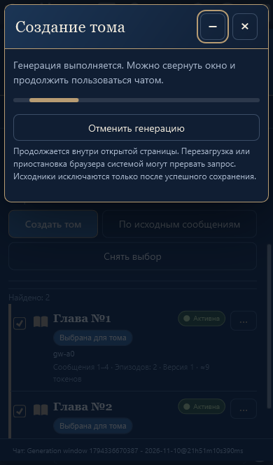
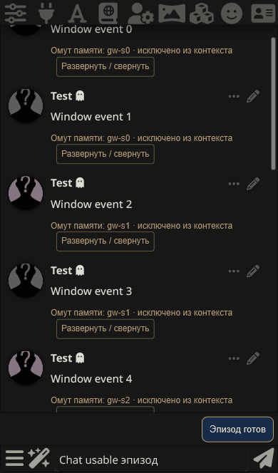

# Сворачивание генерации · v1.6.3

По «текст (8).txt» и приложенному образцу окна. Продолжен выбранный пользователем режим внедрения и публикации без отдельного макета.

Окно создания эпизода, главы или тома содержит **−** рядом с **×**. Оно показывает неопределённый прогресс: достоверный процент API не предоставляет, искусственная шкала не рассчитывается. Палитра и основной интерфейс сохранены.

Минус закрывает только представление прогресса, снимает затемнение и сворачивает основное окно, если оно открыто. Состояние и текущий запрос сохраняются. Единственный индикатор располагается в потоке над формой чата, не поверх кнопок. Отдельная кнопка восстановления основного окна временно уступает ему место и возвращается после завершения работы с результатом.

Запуск кнопкой из чата по-прежнему начинается с неблокирующего прогресса и автоматически показывает предпросмотр результата. Если открыть прогресс через индикатор и нажать минус, это явное сворачивание: по завершении остаётся индикатор готовности. Если результат получен после явного сворачивания, окно не открывается само: индикатор сообщает **«Эпизод готов»**, **«Глава готова»** или **«Том готов»**. По нажатию открывается прежний предпросмотр того же черновика. Двойное нажатие не открывает повторный прогресс или дополнительный запрос.

До подтверждения предпросмотра архив и активность не меняются. Когда предпросмотр эпизодов выключен, успешная ручная генерация сохраняется автоматически, как прежде. Информация о ходе остаётся в индикаторе; дополнительного подтверждения нет. Главы и тома всегда проверяются перед сохранением.

## Отмена, ошибки и сохранность

- Минус не вызывает остановку запроса. «Отменить генерацию», × и Escape используют существующий `Engine.cancel` и штатный `stopGeneration` ST. Проверяется реальный сигнал `GENERATION_STOPPED`; поздний ответ после отмены не открывает результат и не записывает данные.
- Ошибка сохраняется в окне и индикаторе. Открытие показывает её и отдельную кнопку повторного запроса. Источники/границы и сеанс фиксируются; изменённые сообщения или другой чат не становятся незаметно новыми исходниками повтора.
- Ошибка автоматического сохранения предлагает повторить сохранение **того же черновика**. Модель не вызывается заново, существующая защита commit ID не допускает второй записи. При совпадении журнала с ID, версией, текстом и исходниками этого черновика вызывается существующее восстановление Engine. Чужой или изменённый журнал не завершается автоматически: остаётся указание восстановления из настроек.
- Пока подтверждается запись на сервере, отмена/закрытие записи недоступны; можно скрыть окно. Исходники исключаются только существующей проверенной процедурой сохранения.
- Смена чата отменяет запрос и удаляет его представление; исходный архив и другой чат не смешиваются. Одновременно интерфейс удерживает только одну операцию или готовый результат: сначала сохраните/отмените его либо закройте ошибку.

Добавлен UI-контроллер `generation-view.js`; механизмы запроса, лимитов, промптов, хранилища, иерархии, внедрения и Hide не переписаны. Пять пунктов меню и самостоятельное создание из чата сохранены. Штатная блокировка одновременной генерации ST действует и при скрытом окне, при этом доступны чтение/прокрутка чата и ввод черновика.

## Проверки

- RED на v1.6.2: кнопка сворачивания отсутствовала. Затем исправлено повторное восстановление готового результата: двойной click воспроизводил попытку открыть удалённый progress dialog, теперь отсекается состоянием.
- Chromium/Edge и WebKit/iPhone: все три уровня с задержанным HTTP-ответом, скрытие/повторное восстановление без нового запроса, отсутствие записей до Save, скрытый готовый результат, ввод в чат и геометрия индикатора, сохранение эпизода/тома и отмена главы.
- Проверены сохранённая ошибка и двойное нажатие повтора, нативная отмена и отсутствие эффекта позднего ответа, автоматическое сохранение без предпросмотра, ошибка последнего readback и повтор одного сохранения без вызова модели, смена чата во время запроса.
- Независимая проверка выявила и помогла исправить три регрессии: блокирующий запуск из чата, повтор со старыми индексами после удаления предшествующего сообщения и повтор сохранения с незавершённым журналом. Все воспроизведены до исправления. Проверяется также отказ завершать чужой журнал и отсутствие двух индикаторов при изначально скрытом прогрессе.
- `npm test`: **121/121**; `npm run check`: **10 модулей**, версии UI/package/manifest совпадают.

Снимки и браузерные проверки выполнены в одноразовой ST 1.19.0 с синтетическими источниками и ответами модели. WebKit-эмуляция не заменяет физический iPhone. Приостановка Safari системой, перезагрузка или уход со страницы могут прервать запрос; поддерживается сворачивание окна внутри текущей страницы, а не фоновый сервис.
