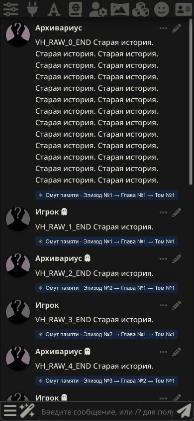

# Раскрытие истории и метки иерархии · v1.6.4

По «текст (9).txt», поверх v1.6.3. Основное окно, ручное создание памяти, промпты, архивный формат, экспорт/импорт и настройка предпросмотра сохранены.

## Что изменилось

Нативное раскрытие сообщения больше не создаёт конфликт с собственной активной памятью. Сообщение остаётся видимым, его текст, флаг `is_system` и метаданные исключений не меняются расширением при сборке запроса. Под ним отображается пассивная метка полной цепочки:

**◈ Омут памяти · Эпизод №1 → Глава №1 → Том №1**

Метка не имеет действий и кнопки «Развернуть / свернуть». Архивные уровни тоже отражаются; удаление связи убирает соответствующую часть цепочки, несколько действительных родителей показываются отдельными цепочками. Старые названия «Сводка / Арка» сохраняют свои номера. Прежнее визуальное сокращение применяется только к нативно скрытым сообщениям: изменение штатного атрибута при раскрытии сразу отменяет сокращение.

## Фактический запрос модели

Стандартный `generate_interceptor` получает отдельный массив уже отформатированных сообщений ST. Перед WI и сборкой Chat/Text Completion расширение обновляет существующий блок памяти и удаляет из этого массива только его подтверждённые локальные исходники. Ключи берутся из UUID сообщений, отпечатки проверяются по живому исходному тексту: regex-форматирование и сдвиг индексов не меняют привязку. Оригинальный массив не принимается как массив запроса.

Активный эпизод покрывает свои исходники, глава — исходники дочерних эпизодов, том — всю соответствующую ветвь. Используется фактический набор эффективных записей памяти; активные флаги подавленных потомков не дают повторной вставки. Без активной памяти, при выключенном внедрении или блокирующем лимите исходники не фильтруются расширением. Существующие блокировки недопустимого блока памяти остаются.

Чужие, изменённые или неоднозначные связи не становятся основаниями для удаления текста запроса. Источники эпизода должны быть полностью подтверждены в текущем чате; сохранены прежние проверки отвязанных импортов. Формат архива и механизм восстановления копий не меняются. Новых переключателей нет.

## Дописывание сообщения

Нативная команда Continue записывает результат поверх последней реплики и берёт её префикс из массива запроса. Если последняя реплика уже покрыта памятью, удалить её из запроса и продолжить запись нельзя: это подменило бы её начало. Поэтому такое дописывание защищено остановкой до HTTP-запроса и записи, с пояснением использовать обычную отправку для нового ответа. Активность воспоминания и раскрытие сохраняются. Обычные новые ответы работают без этой остановки; дописывание новой непокрытой реплики тоже остаётся штатным.

Без выбранного сохранённого чата остаётся прежний пустой снимок памяти: quiet-генерация сторонних инструментов не прерывается, в том числе при выключенном расширении.

## Проверки

- RED на v1.6.3: раскрытие собственного источника давало `blocked=true`; браузер воспроизводил оставшийся визуальный предел `52.5px` после штатного раскрытия. Исправления проверены против этих регрессий.
- Node: **140/140**, синтаксис и совпадение версий **11 модулей**. Проверены эпизод/том, отключённая и неактивная память, лимиты, сдвиги и regex-текст, изменённые/дублированные UUID, иностранное происхождение, исходный массив и смена чата. Метки проверены на архивных уровнях, ветвлениях и удалённых связях.
- Реальная ST1.19.0, Chromium/Edge и WebKit с экраном iPhone: создание/сохранение эпизода, штатное раскрытие, реальный запрос и ответ; главы и том с автоматическим обновлением меток; новая переписка в запросе, отсутствие старых исходников и повторов уровней, выключение памяти, Chat и Text Completion, ручная генерация по покрытым исходникам, перезагрузка и независимый чат с совпавшим UUID.
- Изменения видимости, текста и метаданных исходников проверяются до/после генерации. Модели и история синтетические; физический iPhone отдельно не проверялся. Снимок получен из настоящего интерфейса ST, а не макета.

Независимая проверка выявила опасный prefix/writeback нативного Continue и потерю no-chat fallback. Оба замечания воспроизведены до исправления (включая реальный HTTP-запрос для опасного Continue), исправлены и проверены Node и настоящей ST. Покрыто отсутствие HTTP/записи при защите, возможность обычного ответа сразу после неё, безопасное Continue новой реплики и quiet без чата при включённом/выключенном расширении.
