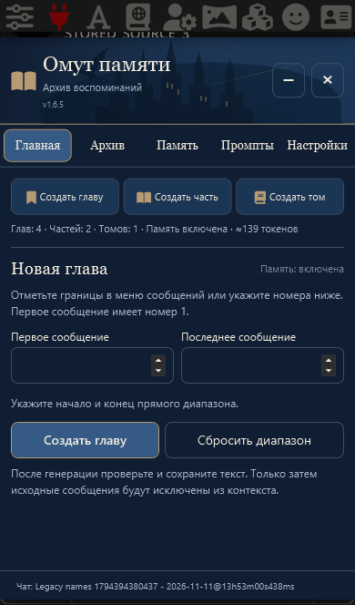

# Глава → Часть → Том · v1.6.5

По «текст (10).txt», поверх v1.6.4. Изменена терминология существующих уровней: прежний эпизод — **Глава**, прежняя глава/арка — **Часть**, том — **Том**. Вкладка **Главная** и оформление сохранены.

## Данные не перезаписываются

Внутренние типы `summary`, `arc`, `volume`, связи `summaryIds`/`chapterIds`, группы промптов и настройка `previewEpisodes` остаются прежними. Миграция отображения выполняется при чтении, без записи новых заголовков в старые данные. ID, исходные диапазоны, тексты, пользовательские названия, история версий, активность и архивные записи сохраняются.

Распознавание старых автоматических префиксов зависит от типа: `summary` понимает «Сводка / Эпизод / Глава», `arc` — «Арка / Глава / Часть». Поэтому прежняя «Глава №3» второго уровня становится видимой «Частью №3», а новая «Глава №10» относится к первому уровню. Суффикс и исходное поле названия не меняются. Следующий номер учитывает все прежние префиксы.

Метка чата остаётся пассивной: **Омут памяти · Глава №9 → Часть №3 → Том №1**. Кнопки, прогресс, предпросмотр, редакторы промптов, настройки, уведомления, статусы и ошибки используют новую терминологию. Сохранённый пользовательский текст промпта и записи может содержать старые слова — они намеренно сохраняются буквально.

Стандартный промпт тома в новых настройках говорит о частях. Существующие тексты пресетов, включая сохранённый старый стандартный промпт, не заменяются. Логика генерации, архивирования, контекста, исключения исходников, сворачивания и резервных копий не изменена; форматы файлов остаются прежними.

## Проверки

- Синтетическая резервная копия и переписка подготовлены кодом опубликованной v1.6.4. В ней есть старые «Эпизод / Сводка / Глава / Арка», произвольные заголовки, история и промпты со старыми словами. Три новых проверки сначала воспроизвели старое отображение/отсутствующие новые префиксы/старое название черновика, затем прошли.
- Node: **144/144**; проверка синтаксиса и совпадения версий — **11 модулей**. Проверяется неизменность всех старых полей, следующий номер и отсутствие дубликатов при повторном импорте.
- Реальная ST1.19.0: старые карточки и метки показывают новые уровни, редактор содержит исходное сохранённое название; старые промпты и настройка предпросмотра неизменны. Экспорт/импорт и перезагрузка сохраняют записи. Из сообщений создаются главы №10 и №11 прежней автоматической процедурой; из них создаётся часть №9 прежним промптом второго уровня, с подтверждением и архивированием глав.
- Браузерные сценарии используют синтетические HTTP-ответы и чаты. WebKit с экраном iPhone проверяет мобильный интерфейс; физический iPhone отдельно не проверялся.

Независимая проверка не выявила проблем совместимости или потери данных и дополнительно подтвердила сохранность точного стандартного промпта тома v1.6.4 без записей при загрузке. Завершены Chromium/WebKit проверки иерархии, генерации/сворачивания, копий, нативного раскрытия и фактических Chat/Text Completion запросов, черновиков промптов и активной памяти. Защита Continue и quiet без чата также сохранены.
