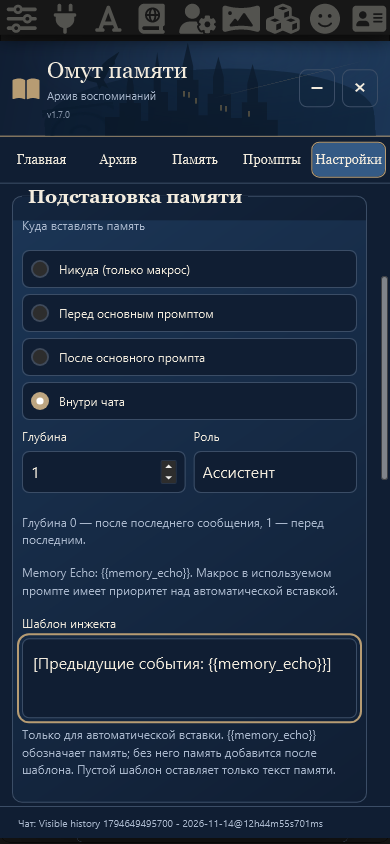

# Memory Echo · v1.7.0

Исправленное ТЗ: четыре штатные позиции SillyTavern вместо отдельного переключателя автоматической вставки. Макрос `{{memory_echo}}` зарегистрирован штатным API, включая новый экспериментальный движок макросов ST1.19.0.

## Настройки

Новые установки используют «После основного промпта». У существующих сохраняются позиция, глубина и прежнее оформление. Роль по умолчанию «Система»; глубина и роль видны только для «Внутри чата». Все параметры сохраняются в прежних настройках и полной резервной копии; старые файлы принимаются без новых обязательных полей.

Memory Echo и автоматическая вставка используют один проверенный блок активных глав, частей и томов. Приоритет определяется по фактически собранному запросу. Несколько пользовательских макросов дают один блок. Шаблон автоматической вставки использует собственный внутренний заполнитель и не считается пользовательским макросом. При выключенной памяти или пустом архиве макрос возвращает пустую строку.

При передаче памяти охваченные исходники исключаются из копии контекста, сохраняя видимость и текст переписки. В режиме «Никуда» без фактического макроса дополнительного исключения нет. Для защиты штатного дописывания покрытого последнего сообщения запрос Continue останавливается до HTTP и записи ответа; обычная новая реплика работает. Генерация глав, частей и томов, буквальные пользовательские промпты и предпросмотр остаются прежними.

## Проверка

- Node: 165 проверок; синтаксис 14 модулей, согласованность версии и манифеста.
- Реальная изолированная ST1.19.0: Chat Completion и Text Completion, четыре позиции, глубина 0/1/4, роли Система/Пользователь/Ассистент, приоритет и повторы макроса, внутренний шаблон, выключенный промпт, деактивация памяти, отсутствие служебных маркеров в HTTP, неизменность исходных сообщений.
- Chromium и WebKit с профилем iPhone, ширина 320/390 px, сохранение параметров после перезагрузки. Физическое устройство отдельно не проверялось.
- Прежние сценарии проверяют архивы и старые копии, раскрытие истории, источники томов, Continue/quiet, сворачивание генерации, создание и резервное копирование.

Ответы моделей во всех браузерных сценариях синтетические; пользовательские чаты не использовались.
