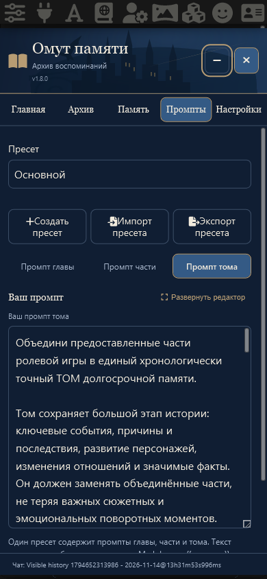

# Общие пресеты промптов · v1.8.0

Один выбор пресета управляет промптами главы, части и тома. Сохранены три редактора, история, развернутый режим и обмен отдельными `.txt`. Компактные действия «Создать / Импорт / Экспорт» доступны рядом с выбором; импорт одного JSON добавляет и выбирает сразу три текста. Совпадение названия разрешается суффиксом, без перезаписи существующего набора.

## Встроенный «Основной»

Три оригинальных файла пользователя перенесены целиком в синхронный модуль, без сетевой загрузки при запуске. SHA256 каждого фактического текста в Engine.prompt и после восстановления/экспорта совпадает с исходным файлом:

| Уровень | Исходный файл | SHA256 UTF-8 |
|---|---|---|
| Глава | pensieve-prompt-summary 2.txt | 11d9a11944cde7ba2ae8b4812b3a518d0dec254d0253bd086d3074843f8fd219 |
| Часть | pensieve-prompt-arc 2.txt | 3939f92cadb31d24590315a889ec6864519bebf34a425feab4a77afb8f478d2f |
| Том | pensieve-prompt-volume 2.txt | febe29bdd01ef69b42f507f08c36b09ebca8ed859cda7ca5a3b274c22fbd8b98 |

Глава и том: максимум 5000 слов. Часть: цель 45–60% исходных глав, максимум 2500 слов. Сохранены все правила источников, хронологии, отношений, Slow Burn и запрет отдельных заключительных разделов о текущем состоянии. Код не обрезает текст по числу слов.

Встроенный набор защищён от удаления/переименования. Его можно редактировать; восстановление трёх исходных текстов сохраняет предыдущие версии и остальные наборы. Обновление сохраняет изменённые пользовательские тексты. Прежние независимые выбранные промпты и все невыбранные записи/история переносятся в общие наборы.

## Память и копии

Шаблон новой установки — `{{memory_echo}}`. Пустой старый шаблон заполняется один раз, непустой остаётся прежним; после миграции его можно намеренно очистить. В режиме «Никуда» шаблон не применяется. Все четыре нативных позиции, роль/глубина, приоритет фактического пользовательского макроса и один активный блок сохранены.

Генерационные запросы используют текущий общий набор буквально. Механизмы создания/архивирования, активная иерархия и данные воспоминаний не менялись. Общие наборы хранятся в прежних глобальных группах настроек с согласованными ID/выбором; отдельного хранилища воспоминаний не добавлено. Полная копия содержит все наборы; коллизии ID сохраняют отличающиеся тексты, повторное восстановление идемпотентно, включая ранее восстановленный и затем изменённый набор.

## Проверка

Node: 192 проверки, синтаксис 16 модулей и согласованность версий. Покрыты старые отдельные выборы, сохранение каждой истории, коллизии названий/ID, пустые и Unicode тексты, точный JSON-обмен, атомарный отказ, восстановление/откат глобальных промптов и журнал операций.

Chromium и WebKit с профилем iPhone проверяют общий выбор/все редакторы, file chooser JSON, экспорт, сохранность «Основного», ошибочный файл, клонирование/правку, фактические запросы главы/части/тома, ширину 320/390 px, перезагрузку и другой чат. Регрессии проверяют черновики, резервные копии и Memory Echo. Модельные ответы синтетические; физическое устройство отдельно не проверялось.

Независимое ревью завершено; три замечания исправлены и сначала воспроизведены регрессионными тестами. Миграция обновляет нетронутые заводские значения отдельно по уровням, сохраняя пользовательские тексты и историю, включая намеренно пустые. Редактор отличает исходный текст от нормализованного отображения textarea: импорт CRLF/CR не создаёт ложного черновика, сохранение без изменений сохраняет исходные байты и не добавляет фиктивную версию. Полная копия объединяет одинаковый по названию, трём текстам и историям набор даже при разных ID на двух установках. Дополнительно проверено восстановление трёх текстов «Основного» через настоящий интерфейс.
