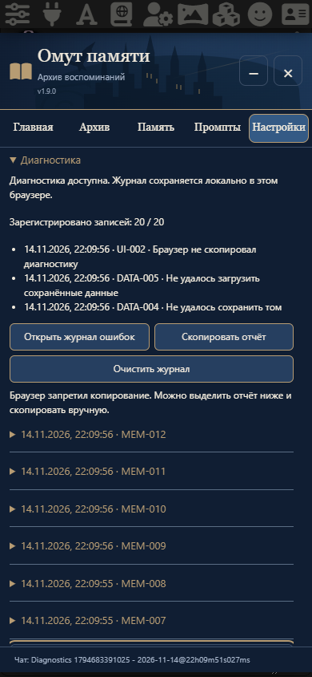

# v1.9.0 · Диагностика

Исправленное ТЗ «текст (16).txt» заменяет предыдущую редакцию. Навигация, архив, иерархия Глава → Часть → Том, общие пресеты и режим подстановки сохранены.

При ошибке над полем ввода появляется компактное уведомление с кодом и этапом. «Подробности» раскрываются на месте; «Копировать диагностику» копирует безопасный отчёт. Уведомление находится в потоке страницы, без перекрывающего слоя и отдельного окна.

Внизу «Настроек» добавлен сворачиваемый раздел «Диагностика»: статус хранилища, последние ошибки, встроенный журнал, копирование отчёта и очистка. Максимум 20 записей, повторы объединяются. Журнал локален для браузера и учётной записи SillyTavern, переживает перезагрузку; при недоступном хранилище явно остаётся только на текущую сессию. Очистка журнала не трогает память и настройки.

Отчёт содержит версии, время, код, операцию, наблюдавшийся этап, статус, класс исключения, подтверждённый HTTP/код API, безопасные позиции в файлах кода, режим подстановки, факт использования макроса, числа активных записей и состояние генерации. Произвольные сообщения исключений и пути скрываются: они могут содержать переписку, имена или секреты. Допускаются только заранее известные сообщения самого расширения и фиксированные коды провайдера. Если точная причина недоступна, отчёт прямо сообщает об этом; HTTP500 не называется превышением контекста.

Ошибки необязательных меток и отображения журналируются как предупреждения. Ошибки, нарушающие корректность контекста, останавливают запрос. На случай отказа native Stop предусмотрена дополнительная защита фактически сериализуемого запроса. Отмена собственной генерации освобождает блокировку даже при зависшем ответе сервера; поздний ответ не сохраняется, автоматического повтора нет.

Поддерживаются Clipboard API и резервное копирование через выделение. Если браузер запретил оба способа, доступен выделяемый полный отчёт для ручного копирования.

## Проверка

`npm test`: 223 проверки; `npm run check`: 20 модулей и согласованность версий; отдельные проверки реального SillyTavern 1.19.0 через Chromium и WebKit с профилем iPhone, ширина 320/390. Ответы API и буфер обмена в браузерных проверках синтетические: обращения к реальной модели отсутствуют.

- Ошибка макроса, отказ native Stop и ошибка исключения исходников: ноль HTTP-запросов, исходный текст сохранён, повторная отправка работает.
- Ошибка API500, сохранения, JavaScript-обработчика, необязательных меток; отмена ожидающего запроса и освобождение блокировок.
- 20 записей, объединение повторов, перезагрузка, очистка без изменения архива/пресетов/позиции памяти.
- Контрольные секреты в сообщениях исключений, чате, памяти и промптах не попадают в собственные отчёты, хранилище и консоль `[Pensieve]`.
- Отказ регистрации макроса: настройки доступны; активный некорректный контекст блокируется, отключённая память не мешает обычному чату.

Эмуляция WebKit не заменяет испытание на физическом iPhone. Произвольные ошибки SillyTavern, других расширений и консоль самого SillyTavern этим журналом не перехватываются.

Независимая проверка кода выявила аварийные сценарии, исправленные регрессионными тестами: неизменяемый промежуточный пакет, перенос raw TC-промпта в другой объект, недоступный сохранённый чат, штатный Stop, отказ подстановки при смене чата, ошибка отрисовки/предпросмотра, доступность настроек при сбое памяти, классификация файловых действий, журнал в нескольких вкладках и точные коды ошибок native CC. Повторный показ готового результата не делает второго запроса к модели.

Известные небольшие ограничения диагностики: счётчики отражают сохранённые флаги активности и могут учитывать дочернюю запись, подавленную активным родителем; ошибка повторного чтения лимитов при финальной сборке может получить этап «передача контекста» вместо «токены». Формирование памяти и безопасная остановка запроса от этого не меняются.

