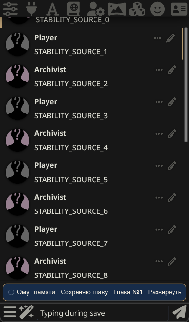

# v1.9.1 · Stability & Recovery

Сохранение, проверка результата и сворачивание исправлены поверх v1.9.0 по «текст (18).txt». Промпты, пресеты, активная и архивная память, иерархия, Memory Echo, позиции подстановки и форматы обмена сохранены. Модули диагностики 1.9.0 не изменялись.

## Подтверждение записи

В исходном коде проверочное чтение выполнялось один раз. Кроме того, ошибка пересчёта активной памяти после подтверждённой записи отклоняла весь вызов сохранения. Это подтверждённые причины возможной ложной ошибки; установить причину конкретного пользовательского случая по одному описанию нельзя.

После записи выполняются максимум три проверочных чтения с задержками 200 и 600 мс. Повторяется проверка, а не запрос к модели или создание новой записи. Проверяются UUID, версия, содержимое, связи и состояние операции. Потерянный ответ на запись допускается подтвердить последующим чтением.

Состояния различаются: сохранено; запись пока не обнаружена; результат пока неизвестен. Доказательство наличия записи отделено от завершения обработки исходников и финального обновления журнала. Если запись уже подтверждена, а последующая проверка не завершена, индикатор сообщает об этом. Исходники не исключаются до проверки сохранённой записи и их происхождения. Ошибка необязательного пересчёта после завершённого сохранения становится предупреждением, а не ложным отказом сохранения.

Проверки ограничены по времени: запись — 15 секунд, чтение — 5 секунд на попытку, собственная проверка токенов — 30 секунд. После ошибки временное состояние освобождается; неизвестный результат остаётся незавершённым. Поздний ответ не подтверждает другую сессию. Пока предыдущая нативная запись ещё выполняется, следующая запись памяти в тот же чат не запускается: она могла бы быть затёрта запоздавшим сохранением. Интерфейс при этом доступен. Когда запись завершится, запускается адресная проверка прежнего ID. Автоматических повторных генераций нет.

## Восстановление

До первой записи создаётся временная квитанция незавершённой операции в штатном браузерном localforage SillyTavern. Квитанция изолирована по аккаунту и чату и содержит ожидаемый снимок архива с ID операции. Переписка, промпты и настройки в неё не копируются. Основной архив по-прежнему хранится в метаданных чата; переноса или пересоздания старых воспоминаний нет. Квитанция удаляется только после подтверждения завершения. До этого она занимает место в этом браузере и не синхронизируется на другое устройство.

При открытии текущего чата проверяются только сохранённая незавершённая операция или её локальная квитанция. Без них дополнительные серверные чтения и пересчёт токенов для восстановления не выполняются. Другие чаты не сканируются и новые сводки автоматически не создаются. При незавершённой записи сравниваются текущий снимок чата и серверная копия, чтобы не затереть изменённые сообщения или более новый архив. Журналы импорта/отката не запускаются автоматически как сохранение главы.

Совпадающая сохранённая запись подтверждается автоматически; при необходимости безопасно завершается прежняя обработка исходников. Если запись отсутствует или проверить её нельзя, результат остаётся доступен для восстановления через существующий раздел настроек. Повторное сохранение использует прежние ID, не создавая вторую главу, часть или том. Более новая или несовпадающая запись не перезаписывается старой квитанцией. Отсутствующий результат при автоматической проверке остаётся только в квитанции, чтобы обычное сохранение чата не записало его без команды пользователя. Незавершённый результат можно открыть и скопировать в настройках. Проверяются также владельцы исключения исходников; одного скрытого флага недостаточно для подтверждения. Явный возврат исходников деактивирует незавершённый результат и восстанавливает прежний выбор активных частей.

Если первая запись полностью не дошла до сервера, после перезагрузки исходные сообщения могут ещё не иметь сохранённых UUID. Они не сопоставляются автоматически по одному похожему тексту. В этом случае «Вернуть исходники незавершённой операции» позволяет сохранить результат в архив без активации и скрытия ненадёжно определённых источников. При недоступности локального хранилища сохранение останавливается до изменения исходников; текст остаётся в открытом предпросмотре для копирования.

## Сворачивание

Кнопка сворачивания доступна в прогрессе и предпросмотре, в том числе во время ручного сохранения. Можно скрыть подсчёт токенов, генерацию, запись, проверку сервера и восстановление. Открывается тот же результат и та же задача. Компактная строка показывает действительный этап, тип записи, результат проверки и кнопку разворачивания; ошибка остаётся доступна до открытия пользователем. Завершение скрытого сохранения не требует открывать предпросмотр для завершения его обработчика.

Сворачивание не посылает Stop. Набор текста, навигация и настройки доступны. Существующая эксклюзивность запроса к модели сохранена на время API: второй запрос должен подождать, о чём сообщает индикатор. Проверка и запись после ответа не удерживают блокировку генерации. Незавершённая память по-прежнему защищает корректность контекста до восстановления.

## Проверка

261 Node-проверка и проверка 21 модуля. В настоящей изолированной копии SillyTavern1.19.0 с синтетическими ответами Chromium/WebKit проверены потерянный ACK, устаревшие первые чтения, ошибка после успешной записи, недоступное хранилище, перезагрузка, восстановление прежнего UUID, сохранность источников и связей, сворачивание всех этапов, скрытые ошибки и повторное открытие без второго запроса. Мобильные размеры — 320/390 px. Дополнительно проверены отложенная до фактической записи отправка, конкурирующие квитанции в Web Locks и резервной транзакции IndexedDB, зависшие скрытие исходников и подсчёт токенов, а также текущий этап в развёрнутом предпросмотре. Физический iPhone и реальные провайдеры не использовались.

## Принятые решения и пределы проверки

- Временная квитанция хранится только в аккаунте/чате текущего браузера. Она нужна для результата, который ещё не дошёл до сервера; на другом устройстве такой результат недоступен. После подтверждения квитанция удаляется. Основной архив не переносится.
- Существующая эксклюзивность запросов к модели сохранена: второй запрос ждёт; набор текста, навигация и настройки доступны.
- Неопределённая нативная запись не считается отменённой по одному таймауту. Следующая запись памяти в тот же чат ждёт её завершения, чтобы поздний ответ не затёр новые данные. Незавершённый текст доступен для просмотра/копирования.
- Изменение сообщений или более новый локальный/серверный архив останавливает восстановление до устранения расхождения. Это защищает свежие данные; автоматическое объединение конфликтующих чатов не добавлялось.
- Квитанции атомарно обновляются через Web Locks, либо транзакцию IndexedDB. Если браузер не позволяет определить наличие незавершённого нативного писателя, сомнительная запись остаётся ожидающей вместо небезопасной перезаписи.
- Старая незавершённая операция без снимка прежней активности не позволяет достоверно восстановить неизвестный прежний выбор. Новые квитанции сохраняют его; история не выдумывается.
- Завершение процесса до появления квитанции сохранения не восстанавливает ещё не сохранённый ответ модели. Автоматическая повторная генерация не добавлялась.
- Точная причина исходного пользовательского инцидента без его журнала остаётся неизвестной. Воспроизведённые сбои исправлены и проверены отдельно.
- Неизменённые промпты, пресеты, компилятор памяти, иерархия, Memory Echo, подстановка, обмен данными и диагностика проверены по границам интеграции; их переписывание не входило в обновление. Физический iPhone и живые провайдеры не проверялись: использовались Chromium/WebKit, синтетические ответы и изолированная SillyTavern.

Все существенные замечания итогового независимого ревью исправлены. Отложенных мелких замечаний нет.
